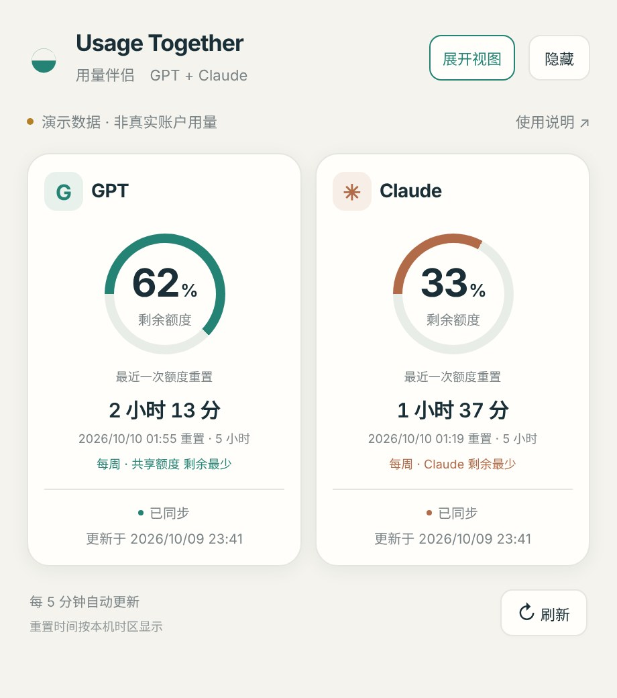
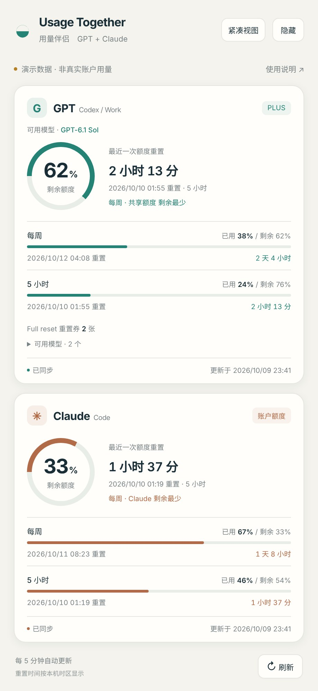

# Usage Together · 用量伴侣

一个 macOS 小工具，在一个悬浮窗口和菜单栏里，同时显示 **GPT（Codex / ChatGPT Work）** 和 **Claude（Claude Code）** 的账户剩余额度和重置时间。

*A small macOS menu-bar app that shows your remaining Codex/ChatGPT and Claude Code usage limits side by side. Read-only: it never sends chats or changes account settings.*

<p align="center">
  
  
</p>

<p align="center"><sub>截图使用程序自带的演示数据，不是真实账户用量。</sub></p>

## 功能

- GPT 和 Claude 各一张卡片，每个额度窗口（比如 5 小时、每周）分别显示已用和剩余比例。
- 显示下次重置的倒计时，以及按本机时区显示的具体日期和时间。
- GPT 会显示账户返回的全部额度分组，并自动读取可用模型列表，以后新增模型不需要改代码。
- Claude 会显示账户实际返回的 5 小时、每周、按模型或 Cowork 等窗口，没有返回的窗口不会凭空生成。
- 服务有返回时，显示 GPT 重置券的数量和最早到期时间。
- 菜单栏显示 `G 50%  C 93%`，即两边各自剩余最少的那个窗口；`*` 表示数据已过时。
- 支持紧凑视图、隐藏到菜单栏，每 5 分钟自动刷新，也可以手动刷新。

## 运行要求

| 项目 | 要求 |
| --- | --- |
| 系统 | macOS 13 或以上 |
| GPT 数据 | 本机已安装并登录 ChatGPT / Codex 桌面版，或 Codex CLI |
| Claude 数据 | 本机已安装并登录 Claude Code |
| 构建和测试 | Node.js 20 或以上（Apple Silicon 电脑需要 arm64 版本） |
| 第三方依赖 | 无，只用 Node.js 自带模块 |

只登录了其中一边也可以用，另一边会显示「—」和提示。

## 快速开始

```sh
git clone https://github.com/PaulChen0508/usage-together.git
cd usage-together

npm test          # 运行 11 项自带测试
npm run preview   # 用演示数据启动本地服务，把输出的地址粘到浏览器里就能预览界面
npm run build     # 构建应用，输出到 dist/Usage Together.app
```

也可以不用 npm，直接运行：

```sh
sh build.sh "/绝对路径/Usage Together.app" "$(which node)"
```

`build.sh` 会把你指定的 Node.js 可执行文件一起打包进应用，所以构建出来的应用在别的 Mac 上不需要再装 Node。应用使用本地临时签名，没有经过 Apple 公证，第一次打开时可能需要在「系统设置 → 隐私与安全性」里点「仍要打开」。

## 使用

- 拖动标题栏移动窗口，窗口可以调整大小。
- 右上角「紧凑视图 / 展开视图」切换显示方式。
- 「隐藏」或窗口的关闭按钮只会隐藏窗口，程序在后台继续更新；点菜单栏的 `G … C …` 可以重新显示。
- 菜单栏里的「退出用量伴侣」，或「使用说明」里的「退出程序」，会完全退出应用和本地服务。
- 如果 Claude 显示「未找到登录信息」，先在 Claude Code 里登录，再点「刷新」。第一次读取钥匙串时 macOS 会弹出授权提示。

## 数据范围和准确性

- 这里的 GPT 额度是 **Codex / ChatGPT Work 的账户额度**，不包括普通 ChatGPT 网页对话的消息次数，也不包括 OpenAI API 的账单用量。多个模型可能共用一份额度，程序不会给每个模型编一个独立额度。
- 剩余比例 = 100% − 已用比例，不能换算成固定的聊天次数。
- 账户没有返回的数据显示「—」，不会当成 0% 或 100%。
- 到了重置时间后会显示「待刷新确认」，等服务返回新数据再更新，不会在本地自己清零。
- 读取失败时保留上一次成功的数据，并标明是旧数据。
- Claude 接口返回 HTTP 429（限流）时，程序会暂停查询 15 分钟。

## 工作原理

- **GPT**：在本机启动 `codex app-server`，只调用 `account/rateLimits/read` 和 `model/list` 两个只读接口。
- **Claude**：从 macOS 钥匙串读取 Claude Code 的登录令牌，只在内存中使用，用它请求 `https://api.anthropic.com/api/oauth/usage`。
- **界面**：由一个只监听 `127.0.0.1` 的本地服务提供，地址里带有每次启动随机生成的访问码，并检查 Host 和 Origin，其他网页无法访问。
- **原生窗口**：`native.js` 用 macOS 自带的 JavaScript for Automation (JXA) 创建悬浮窗口和菜单栏图标。

## 隐私和安全

- 只读取用量和模型列表，不发送聊天，不消耗重置券，不修改任何账户设置。
- 登录令牌不会写进文件、日志或界面，出错信息也会过滤掉原始服务器返回内容。
- 最近一次成功读取的用量保存在 `~/Library/Application Support/Usage Together/usage.json`，只包含用量、模型列表、时间和错误提示，不包含任何凭据。
- 不会把任何数据上传到第三方服务器。

## 项目结构

| 文件 | 作用 |
| --- | --- |
| `backend.js` | 本地服务：读取 GPT 和 Claude 用量、整理数据、缓存、提供界面 |
| `native.js` | macOS 原生悬浮窗口和菜单栏 |
| `index.html` / `ui.js` / `style.css` | 窗口里显示的界面 |
| `test.js` | 自动测试（数据解析、模拟 Codex、本地服务的访问限制、退出流程等） |
| `build.sh` | 构建 `.app` 应用包 |
| `AppIcon.icns` | 应用图标 |
| `package.json` | 项目信息和 `npm` 命令 |
| `Node-LICENSE.txt` | 打包进应用的 Node.js 的许可证 |

## 常见问题

**Claude 显示「登录已过期」**：在 Claude Code 里重新登录，然后点刷新。程序不会自己续期登录。

**GPT 显示「未找到 Codex」**：安装 ChatGPT / Codex 官方桌面版或 Codex CLI。如果装在不常见的位置，可以用环境变量 `USAGE_CODEX_PATH` 指定路径。

**数字后面有 `*`**：表示数据超过 10 分钟没更新，或者已经过了重置时间还没刷新到新数据。

## 版本记录

- **2.0.2**：修复切换紧凑视图时闪退的问题；「紧凑视图」和「隐藏」改为文字按钮。
- **2.0.1**：修复隐藏和退出按钮；退出时会同时结束本地服务。
- **2.0.0**：重写数据层，支持全部 GPT 额度分组、自动读取模型列表、Claude 两种返回格式。

## 注意

- 这是个人项目，**不是 OpenAI 或 Anthropic 的官方产品**，与它们没有任何关联。
- Claude 的用量接口没有公开文档，服务端以后的变动可能导致读取失败。

## 许可

代码使用 [MIT License](LICENSE)。`Node-LICENSE.txt` 是打包进应用的 Node.js 运行时的许可证。
