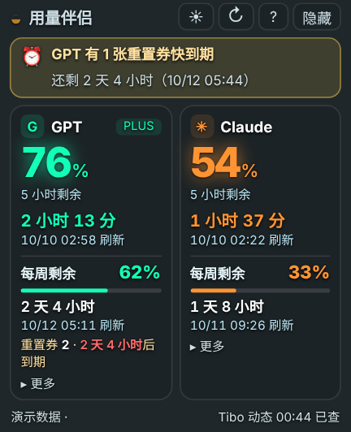
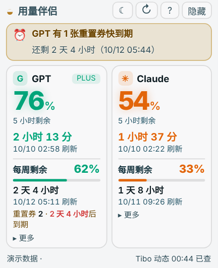

# Usage Together · 用量伴侣

**English** | [中文](README.zh-CN.md)

A small macOS menu-bar app that shows how much **GPT (Codex / ChatGPT)** and **Claude** usage you have left, side by side. It also shows reset times and reset credits, and warns you when a usage reset is coming.

<p align="center">
  
  
</p>

<p align="center"><sub>The screenshots use the app's built-in demo data, not real account usage.</sub></p>

## Features

- **Menu bar** shows the 5-hour usage left on both sides, for example `G 76%  C 54%` (G = GPT, C = Claude, `*` means the data is out of date).
- **Small floating window.** The big number on each side is the 5-hour usage left. Under it you see the 5-hour reset countdown, the weekly usage left and the weekly reset time. Click "更多" (More) to see other limits, such as weekly limits for each model.
- Claude's 5-hour window only starts when you send your first message. Until then the app shows "还没开始计时" (not started yet). GPT's reserved limits are not shown.
- **Reset-credit reminders.** The app shows how many reset credits you have for GPT and Claude. When a credit will expire within 3 days, it reminds you once, then every 12 hours until you use it or it expires.
- **Tibo reset alerts.** Every 10 minutes the app checks Tibo's public posts on X (and retries within a few minutes if a check fails). It understands short posts like "Global reset by EOD". Once a reset post is found, the ⚠︎ in the menu bar and the warning in the window stay until your GPT weekly limit has actually reset. A 5-hour reset, marking the alert as read, reopening the app or a failed check will not clear it early. Each post sends only one system notification. Posts saying a reset is already done, or about reset credits, are shown as information.
- **Dark and light themes.** Switch with ☀ / ☾ in the top-right corner.
- The window shows on every desktop and over full-screen apps, so it stays with you when you switch apps or desktops.
- Refreshes automatically every 5 minutes. Click ↻ to refresh now.

## Requirements

| Item | Requirement |
| --- | --- |
| System | macOS 13 or later |
| GPT data | ChatGPT / Codex desktop app, or Codex CLI, installed and signed in on this Mac |
| Claude data | Any one of: Claude Code signed in, the Claude desktop app signed in, or a sessionKey you paste in |
| Build and test | Node.js 20 or later (arm64 build on Apple Silicon Macs) |
| Third-party packages | None. Only Node.js built-in modules and tools that come with macOS |

It also works if you only use one of the two services. The other side shows "—" and a hint.

## Quick start

You can download the ready-made macOS app from [Releases](../../releases/latest). The download only contains the app and the Node.js runtime. It does not contain anyone's account data.

```sh
git clone https://github.com/PaulChen0508/usage-together.git
cd usage-together

npm test          # run the tests
npm run preview   # start the local service with demo data; open the printed address in a browser to preview the window
npm run build     # build the app into dist/Usage Together.app
```

Without npm, you can run:

```sh
sh build.sh "/absolute/path/Usage Together.app" "$(which node)"
```

`build.sh` copies the Node.js binary you give it into the app, so the built app runs on other Macs without installing Node. The app is signed locally (ad-hoc) and is not notarized by Apple. The first time you open it, you may need to go to System Settings → Privacy & Security and click "Open Anyway".

## How to use

- **Click** the numbers in the menu bar to open the menu. **Double-click** to open the window, and double-click again to hide it.
- Drag the thin strip at the top of the window to move it.
- Top-right of the window: ☀ / ☾ switches the theme, ↻ refreshes, ? shows help, and "隐藏" (Hide) puts the window away in the menu bar.
- To quit, use "退出" (Quit) in the menu bar menu, or "退出程序" in the help panel.

### If Claude usage can't be read

The app tries three ways to read Claude usage, in this order:

1. **Claude Code sign-in**, from the macOS Keychain or `~/.claude/.credentials.json`.
2. **A sessionKey you paste in.** When Claude can't be read, the window shows "Claude 读不到？手动填写 sessionKey". Sign in to claude.ai in your browser, open Developer Tools → Application / Storage → Cookies → claude.ai, copy the value of `sessionKey` (it starts with `sk-ant-`) and paste it in.
3. **Claude desktop app sign-in**, read from the desktop app's local data. The first time, macOS asks for Keychain access ("Claude Safe Storage"). Click "Always Allow".

## What the numbers mean

- The GPT numbers are your **Codex / ChatGPT account limits**. They do not include OpenAI API billing. Several models may share one limit; the app does not invent a separate limit for each model.
- Usage left = 100% − usage used. It can't be turned into a fixed number of messages.
- If the account doesn't return a value, the app shows "—". It never treats a missing value as 0% or 100%.
- If a check fails, the app keeps the last good data and marks it as old.
- If a service returns HTTP 429 (rate limited), the app stops asking it for 15 minutes.
- Tibo alerts depend on public sources: FxTwitter, a public X mirror and X's own timeline. Unreliable sources are tried a few times. A source that only returns old posts does not count as a successful check. The window only says the posts can't be read after several failures in a row, and the app keeps retrying every few minutes. Sources may be cached, so alerts can't be guaranteed to be instant.
- A reset warning is cleared by your account's weekly limit, not by "end of day" or a fixed 24 hours. It clears when a new weekly period starts, or when weekly usage drops to zero or drops clearly. Usage updates every 5 minutes, so the warning may clear a little late.

## How it works

- **GPT:** starts `codex app-server` on your Mac and only calls two read-only methods: `account/rateLimits/read` and `model/list`.
- **Claude:** with a Claude Code sign-in, it calls `api.anthropic.com/api/oauth/usage`. With a sessionKey or the desktop app sign-in, it calls the usage endpoint on `claude.ai`.
- **Tibo posts:** tries the FxTwitter public API, a public X mirror and X's timeline, in that order. Each source can be retried, and a source that only has old posts does not count. Only Tibo's own posts are used; news, other authors, quoted old posts and unrelated "resets" are ignored. The first reset post found and the weekly-limit readings are saved on your Mac, so the warning can stay on and notifications are not repeated.
- **Network:** uses macOS's own networking first, so it follows your system proxy. If that doesn't work on your system, it falls back to Node.js's built-in `fetch`.
- **Window content:** served by a local service that only listens on `127.0.0.1`. The address includes a random access code created at each start, and the service checks the Host and Origin headers, so other web pages can't read it.
- **Native window:** `native.js` uses JavaScript for Automation (JXA), which comes with macOS, to create the floating window and the menu-bar item. It never waits on the local service. Instead it reads a small status file that the service writes into a private temp folder, so the main thread can't get stuck on the network.
- **Self-recovery:** the menu-bar app writes a heartbeat file every 3 seconds. If the heartbeat stops for 60 seconds while the Mac is awake, the local service closes the stuck app and opens it again. If the local service stops answering, the menu-bar app restarts it. When the app starts, it also closes any other copy that is still running.

## Privacy and security

- The app only reads usage. It never sends chats, never uses reset credits and never changes account settings.
- Sign-in data that the app reads is only kept in memory. It is only sent to the matching account service (Anthropic / claude.ai; the official Codex app manages its own sign-in). It is never sent to GitHub, X mirrors or any other public service, and it is never written to logs or shown in the window.
- The app saves these files in `~/Library/Application Support/Usage Together/`. Only you can read or write them:
  - `usage.json`: the latest usage numbers (no sign-in data)
  - `reminders.json`: which reminders were already sent
  - `tibo.json`: public reset posts, the warning state and weekly-limit readings; local data only, never uploaded
  - `theme.txt`: dark or light
  - `claude-session-key`: only exists if you pasted a sessionKey; click "清除" (Clear) in the window to delete it
- Sign-in data, caches, reminder state and account screenshots are not part of the source code or the download. `.gitignore` also ignores these files. Still check the actual file list before publishing, because ignore rules can't remove files that were already committed.

## Project files

| File | What it does |
| --- | --- |
| `backend.js` | Local service: reads GPT and Claude usage and Tibo posts, sends reminders, caches data and serves the window |
| `native.js` | Native macOS floating window and menu-bar item |
| `index.html` / `ui.js` / `style.css` | What the window shows |
| `test.js` | Tests for data parsing, a fake Codex, local-service access rules, quitting, the status file, the watchdog and more |
| `tibo.test.js` | Tests for reset-post detection, sources and retries, lasting warnings, clearing on weekly reset, restarts and notification de-duplication; uses public posts and fake usage |
| `build.sh` | Builds the `.app` bundle |
| `AppIcon.icns` | App icon |
| `package.json` | Project info and `npm` scripts |
| `Node-LICENSE.txt` | License for the Node.js runtime bundled in the app |

## FAQ

**Claude says the sign-in has expired:** open Claude Code or the Claude desktop app once so the sign-in renews, then click refresh. You can also paste a sessionKey instead.

**GPT says Codex was not found:** install the official ChatGPT / Codex desktop app or the Codex CLI. If it's installed somewhere unusual, set the `USAGE_CODEX_PATH` environment variable to its path.

**There's a `*` after a number:** the data hasn't updated for more than 10 minutes, or the reset time has passed and new data hasn't arrived yet.

## Version history

- **2.3.5** (current): Fixed the menu bar freezing and double-click not opening the window. After an update, an old copy of the app kept running. Because both copies share one app ID, opening the new app only woke up the old one, whose window files had already been deleted, so the window was empty. Now the app closes any other running copy when it starts. If the running app file is deleted or replaced, it switches to the installed app. Window files are loaded into memory at start, so moving the app no longer leaves an empty window. If the window is covered or not responding, double-click shows and reloads it instead of hiding it. Also fixed Tibo posts often failing to load: the old X mirror had shut down, and X's timeline was often rate limited and only returned posts that were months old. Added FxTwitter as a source with automatic retries; old posts no longer count as a successful check; a failed check is retried after about 2 minutes instead of 10; "can't read" is only shown after several failures in a row.
- **2.3.4:** Fixed the whole app freezing after a while, with double-click unable to open the window until you quit and reopened it. The menu-bar app used to ask the local service for data on the main thread every 3 seconds, and one stuck request froze everything. Now it reads a status file that the service writes every 2 seconds, so the main thread never waits on the network. "Refresh now" runs in a separate curl process, restarting the service no longer blocks the window, and system notifications come from the service. Added a watchdog: if the menu-bar app has no heartbeat for 60 seconds while the Mac is awake (except while its menu is open), the service closes and reopens it.
- **2.3.3:** Fixed a Tibo reset warning being shown as "Claude 有 undefined 张重置券快到期" (Claude has undefined reset credits expiring). Fixed the window freezing or not opening after long use: menu-bar numbers update every 3 seconds with shorter waits; starting and restarting the service have time limits; the window page reloads if macOS closes it; App Nap is turned off so the menu bar stays quick; a window that ended up off screen is moved back to the main screen.
- **2.3.2:** A reset warning now stays from the moment it's found until the GPT weekly limit actually resets. 5-hour resets, marking as read, reopening and failed checks don't clear it, and old posts don't trigger it again. Stronger ignore rules for local cache and sign-in files.
- **2.3.1:** Fixed broken Tibo sources, missed short posts and a wrong "checked" status. Separated "reset coming", "reset done" and reset-credit posts; reminders are no longer repeated and survive a restart.
- **2.3.0:** The menu bar and window now focus on the 5-hour usage left. Added dark and light themes, reset-credit reminders, Tibo reset alerts and system notifications. Claude can now be read from the Claude desktop app or a pasted sessionKey. The window became a small floating panel that shows on every desktop and over full-screen apps. Click the menu bar for the menu, double-click to open or hide the window.
- **2.0.2:** Fixed a crash when switching to compact view.
- **2.0.1:** Fixed the hide and quit buttons; quitting now also stops the local service.
- **2.0.0:** Rewrote the data layer. Supports every GPT limit group, reads the model list automatically and handles both Claude response formats.

## Notes

- This is a personal project. It is **not an official OpenAI or Anthropic product** and is not connected to either company.
- Claude's usage endpoint is not publicly documented, so future changes on their side may break it.
- The app's interface is in Chinese. Words in quotes above, such as "更多", are the labels you'll see in the app.

## License

The code is under the [MIT License](LICENSE). `Node-LICENSE.txt` is the license for the Node.js runtime bundled in the app.
